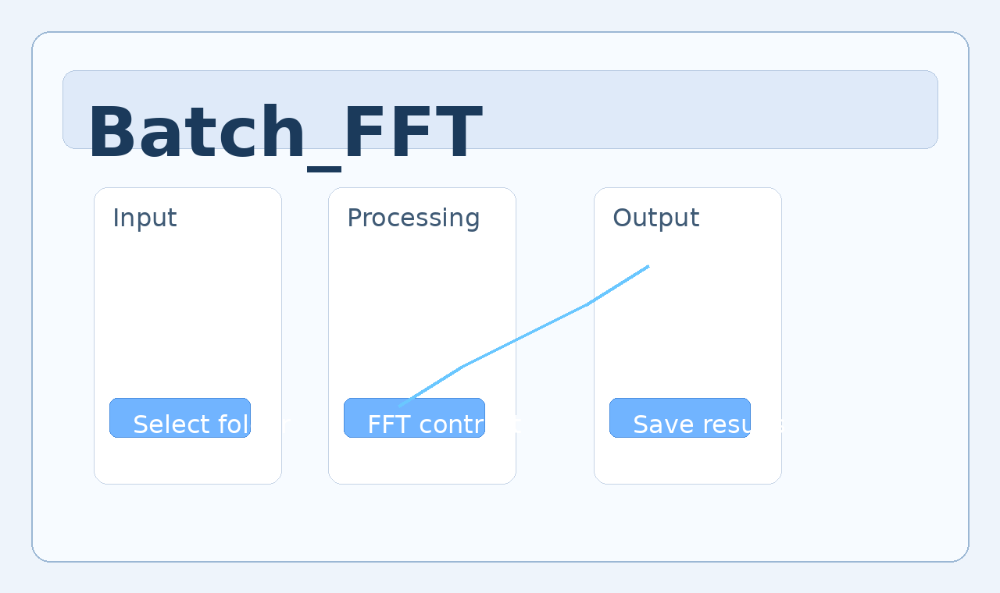

# Batch_FFT

Batch_FFT is a lightweight tool for reducing image size and improving contrast on scientific images, especially cryo-electron microscopy data captured in super-resolution mode by detectors such as the Direct Electron Apollo. The project focuses on a quick, batch-oriented preprocessing workflow for inspection and downstream analysis.


## Files in this repository

- `batch_fft.py` — command-line app for batch FFT-based resizing and contrast enhancement
- `README.md` — project overview and usage notes
- `Logo_TEMC2.png` — project logo
- `Batch_FFT.pdf` — project summary document
- `Interface_GH.png` — example interface screenshot

## Short introduction of `batch_fft.py`

`batch_fft.py` walks through a folder of images, converts each frame into the frequency domain, applies a logarithmic FFT magnitude transform, and rescales the result to improve contrast. This workflow is useful when the input images are large or noisy and need a cleaner, more compact representation before review or further processing.



## Quick usage

```bash
python batch_fft.py --input-dir ./images --output-dir ./processed --target-width 1024 --target-height 1024 --contrast 1.5
```

The script will scan the input folder for common image formats, process each file in turn, and save the enhanced output to the specified directory.

## Project references

- [Batch_FFT.pdf](Batch_FFT.pdf)
- [Logo_TEMC2.png](Logo_TEMC2.png)
- [Interface_GH.png](Interface_GH.png)
